<div align="center">



<br><br>

<a href="https://www.linkedin.com/in/yasmine-shili"></a>
<a href="mailto:yasmine.shili.04@gmail.com"></a>
<a href="https://yazz.sh"></a>
<a href="https://www.root-me.org/yazz"></a>

</div>

---

## 👩‍💻 About me

```yaml
name:        Yasmine Shili
role:        Cybersecurity engineering student — ESPRIT, Tunis (2022 – 2027)
track:       Network Infrastructure & Data Security
exchange:    Université de Lille, France — Master "Cybersécurité : du edge au cloud" (2025)
mindset:     Purple team — attack it, detect it, harden it
focus:       [Detection Engineering, Red Team / AD, Cloud & Kubernetes Security, AI/LLM Security]
languages:   { French: C1, English: C1, Arabic: native, German: A2, Spanish: A1 }
looking_for: 6-month PFE internship (stage de fin d'études) starting January 2027
mobility:    Tunis 🇹🇳 · open to relocating to France 🇫🇷
```

I like working on both sides of an attack. I build offensive labs, then write and test the detection for each technique. I document everything so another analyst can reproduce it. I've done internships in **SOC / detection engineering**, **cloud & AI security**, and **pentest / red team (PASSI)**, so I'm comfortable going from an alert to a root cause to a remediation.

> 🎯 **PFE search:** I'm looking for a final-year internship in **detection engineering**, **red team**, or **AI security**. If your team has a topic, I'd be glad to talk. [Email me](mailto:yasmine.shili.04@gmail.com) or reach me on [LinkedIn](https://www.linkedin.com/in/yasmine-shili).

---

## 💼 Experience

| Period | Role | Company | Highlights |
|:--|:--|:--|:--|
| **Jun – Sep 2026** | Pentest & Red Team Intern | Next Step IT, Tunis | 5 audit missions (AD, Web/API, Azure/Entra ID) · 40+ vulnerabilities reported, including a full domain compromise · built an internal AD recon automation tool · PASSI-style reporting |
| **Mar – Apr 2026** | Cloud & AI Security Intern | Tunisie Telecom, Tunis | Security review of a product AI assistant: 6 prompt-injection / tool-abuse flaws fixed before go-live · CSPM rollout with Prowler: −70% critical AWS findings in 8 weeks |
| **Jun – Sep 2025** | SOC & Detection Engineering Intern | GoTrust Consultings, Tunis | 60 detection rules shipped and tested (Wazuh, Elastic, Sigma, Atomic Red Team) · −30% false positives on PowerShell & authentication alerts |
| **2025 – now** | Bug bounty hunter | YesWeHack · Intigriti | 25 validated vulnerabilities (2 critical) · Hall of Fame on 4 programs |
| **2022 – 2024** | Earlier internships | Next Step IT · B2M IT · TOPNET · Tunisie Telecom | DFIR & threat-hunting framework (Sysmon, Velociraptor, YARA, Sigma) · RBAC & audit features · SQL |

---

## 🛠️ Projects

### ✅ Published

<table>
<tr>
<td width="100%">

#### 🔐 [devsecops-secure-cicd-pipeline](https://github.com/yazz-Sh/devsecops-secure-cicd-pipeline)

A GitHub Actions pipeline that runs security checks on every push to a Node.js/Express app before it ships.

`Semgrep (SAST)` → `Gitleaks (secrets)` → `Trivy (deps + image)` → `Docker build` → `OWASP ZAP (DAST)` → reports uploaded as artifacts

**Next:** blocking gates on high/critical findings, SARIF in the GitHub Security tab, SBOM, and IaC scanning.


</td>
</tr>
</table>

### 🚧 Write-ups & repos coming soon

| Project | What it does | Stack |
|:--|:--|:--|
| **SENTINEL-AI** — open-source SOC copilot | Enriches, summarises and prioritises alerts, then suggests a hunting query and a playbook. Presented at Le Hack and in a SSTIC rump session | Python · local LLMs · RAG · Wazuh · Elastic · MISP · OpenCTI |
| **Detection-as-Code Lab** | Each rule is tested automatically against attack emulation, and ATT&CK coverage is measured and published | Sigma · Sysmon · Atomic Red Team · Caldera · GitHub Actions |
| **Red Team AD Lab** | 12 Active Directory attack chains, each paired with its detection, remediation and a PASSI-style report | GOAD · BloodHound · ADCS · Kerberos · Sliver · Impacket |
| **Cloud Attack & Defense Range** | Rebuilt in about 10 minutes · emulated cloud attacks · 40 CloudTrail/K8s detections · signed CI/CD chain (SLSA) | Terraform · AWS · Kubernetes · Stratus Red Team · Falco · Kyverno · Sigstore |
| **Vulnerability research** | Bugs found in an open-source project and a consumer router · write-ups published after the fixes | AFL++ · Ghidra · IoT firmware |

<!-- Add a link to each repo as soon as it's public. Recruiters click links. -->

---

## 🧰 Toolbox

**Languages & infra**


<br>

**Query languages:** `KQL` · `SPL` · `Sigma` · `YARA`

**Defensive — SOC, detection & DFIR**


**Offensive — red team & pentest**


**Cloud, DevSecOps & AI security**


**Frameworks & compliance:** `ANSSI PASSI / PRIS` · `NIS2` · `DORA` · `EBIOS RM` · `MITRE ATT&CK`

---

## 🏅 Certifications

<div align="center">


<sub>🔴 Offensive · 🔵 Defensive · 🟣 Cloud & DevSecOps — also: HTB AI Red Teamer path · SecNumacadémie (ANSSI) · Cisco CyberOps · CCNA · Fortinet NSE</sub>

</div>

---

## 🏆 Community & achievements

- 🎤 **Talks:** Le Hack · SSTIC rump session · BSides · OWASP meetups
- 🌐 **Open source:** 30+ rules merged into **SigmaHQ** · Velociraptor artifacts · Atomic Red Team tests
- 🚩 **CTF:** FCSC (ANSSI) · Root-Me **top 1%** · HTB **Pro Hacker** · author of 15 CTF challenges
- 🏗️ **Leadership:** founder of **ESPRIT Women in Cyber** · organiser of a national CTF (200 teams) · AIESEC manager
- 🥇 **Best Project of the Year** — ESPRIT

---

<div align="center">

### 📬 Let's talk

**Have a PFE topic in detection, red team or AI security?** I'd like to hear about it.

<a href="https://www.linkedin.com/in/yasmine-shili"></a>
<a href="mailto:yasmine.shili.04@gmail.com"></a>


</div>
